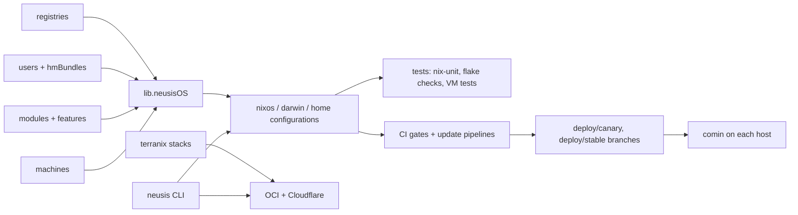

# neusis: architecture

The design of the code for [[PRJ-0001]]. Decisions with their alternatives are recorded one
per file in `decisions/`; this document says how the pieces fit and links them. The
decisions that predate the notebook were backfilled as ADR-0002 to ADR-0014; the
day-by-day history before 2026-11-03 is `porting.md`.

## Goals and constraints
- Configure every machine of the fleet (macOS laptops, lab Linux builders, OCI cloud
  hosts) and every user's home from one flake, on NixOS, nix-darwin and standalone
  home-manager.
- Be a library as well as a fleet: consumer repos import `flakeModules.default` and the
  exported `nixosModules` / `darwinModules` / `homeModules` without inheriting our machines.
- No surprises: every feature is opt-in per user or per machine; shared defaults never
  turn something on.
- Never hardcode a system; the registries drive which systems are built.
- Secrets never exist in plaintext in the repo (agenix-rekey).
- Every change is checkable before a switch: the T0–T4 ladder in `testing.md`.

## Data model
- **Registries** (`modules/registry/`): machines (system, roles, host keys), users,
  builders, deploy groups and signers, grouped by lab (`anklab`, `cslab`, …). The source
  of truth for who and what exists.
- **Machines** (`modules/machines/<host>.nix`): one file per host, importing modules and
  features; `_`-prefixed files are shared snippets.
- **Users** (`modules/users/<user>/`): home bundles (`hmBundles.<name>`) and a
  `machineToBundlesMap` saying which bundles land on which host.
- **Modules and features**: reusable modules in `agnosticModules/`, `nixosModules/`,
  `darwinModules/`, `homeModules/`; opinionated wiring in `features/`.
- **Secrets** (`modules/secrets/`): `.age` sources per user and common, rekeyed per host
  under `rekeyed/<host>/`.
- **Derived and rebuildable**: `flake.nix` (flake-file), `flake.lock`, the rekeyed
  secrets, the encrypted terraform state under `infra/<stack>/`, the docs site.

## Components

- `modules/lib/neusisOS.nix` (`mkNeusisOS`, `mkNeusisDarwinOS`, `mkNeusisFlake`)
  assembles a host from its machine module, an account per registered user and the
  home-manager wiring for those users' bundles.
- `modules/tests/` mirrors the tree: one `<name>.test.nix` per module, feature and machine.
- `.github/workflows/`: `tests.yml` and `gates.yml` build and test, `update-inputs.yml`
  bumps inputs, `pipeline.yml` / `promote.yml` move commits to the `deploy/*` branches
  that comin on each enrolled host follows (`auto-update-spec.md`).
  `kalam-zero-release.yml` republishes kalam-zero's `init.lua` on the rolling
  `kalam-zero` release after its headless test passes (ADR-0016).
- `modules/infra/` + `modules/terranixModules/`: OpenTofu stacks for the OCI base image,
  the hosts, and Cloudflare tunnels (`cloud/tutorial.md`).
- `cli/`: the Go `neusis` CLI (scaffolding, `cloud bootstrap`, `cloud deploy`).
- `modules/packages/`: kalam (nixvim flavours, including kalam-zero for machines without
  Nix), gclb, neusis-cli.

## Stack
- Nix flakes with flake-parts, the dendritic pattern via import-tree, and flake-file for
  the generated `flake.nix` (ADR-0002), under a typed `flake.neusis.*` schema (ADR-0003).
- Modules that run on both platforms dispatch on their options set (ADR-0004), and
  everything is opt-in (ADR-0005).
- nixpkgs, nix-darwin and home-manager on 26.05, plus `pkgs.unstable`.
- agenix-rekey for secrets (ADR-0006); nix-unit and NixOS VM tests (ADR-0007);
  Tailscale with profiles (ADR-0008).
- terranix + OpenTofu for cloud infrastructure (ADR-0010), one base image plus bootstrap
  (ADR-0011).
- comin pull deploys from signed `deploy/*` branches (ADR-0012), driven by a GitHub App
  (ADR-0013), with an attic cache planned (ADR-0014).
- Go for the CLI.

## Phases
The project page's *Progress* checklist tracks the milestones; the specs that plan the
larger ones are `auto-update-spec.md` and `cloud-terranix-spec.md`.

## Open questions
See *Open questions* on [[PRJ-0001]].
